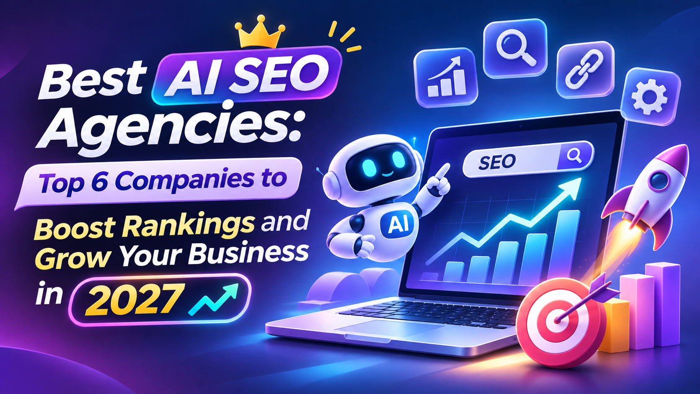

# Best AI SEO Agencies: Top 6 Companies to Boost Rankings and Grow Your Business in 2027

[Explore the website](https://www.yttags.com/) to discover useful insights about digital marketing and search engine optimization. Choosing the right SEO agency can help businesses improve their online presence and reach their target audience.

The Best AI SEO Agencies use advanced artificial intelligence, data-driven strategies, and modern SEO techniques to improve search engine rankings and organic visibility.

These agencies provide services such as AI-powered keyword research, content optimization, technical SEO, competitor analysis, and search performance tracking.

In this guide, we will explore the [**Best AI SEO Agencies**](https://www.yttags.com/best-ai-seo-agencies/) and highlight six agencies that can help businesses increase organic traffic, strengthen online visibility, and achieve long-term growth.

## Understanding the Role of AI SEO Agencies

AI SEO agencies combine artificial intelligence, advanced SEO tools, and data-driven strategies to improve website visibility and search engine rankings. They help businesses optimize their online presence, attract organic traffic, and build effective SEO campaigns.

These agencies use AI technology to simplify SEO tasks, analyze search trends, and identify opportunities for better performance.

- AI-Powered Keyword Research: Finding relevant keywords and search opportunities to target the right audience.
- Content Optimization: Improving website content for search engines and user experience.
- Technical SEO: Identifying website issues that affect crawling, indexing, and performance.
- Competitor Analysis: Analyzing competitors to discover ranking opportunities and content gaps.
- Link Building: Developing strategies to improve website authority through quality backlinks.
- Performance Tracking: Monitoring keyword rankings, organic traffic, and SEO campaign results.
- AI Search Optimization: Improving content visibility across AI-powered search platforms.

By combining human expertise with AI-powered tools, these agencies help businesses develop smarter SEO strategies and achieve sustainable online growth.

## Quick Comparison of the Top 6 Best AI SEO Agencies

| Agency Name          | Headquarters       | Core Services                            | Best For                 | SEO Focus              |
| -------------------- | ------------------ | ---------------------------------------- | ------------------------ | ---------------------- |
| iPullRank            | New York, USA      | AI SEO, GEO, Technical SEO               | Enterprise Businesses    | AI Search Optimization |
| Siege Media          | Austin, USA        | Content Marketing, GEO, Digital PR       | Established Brands       | Content Optimization   |
| Omniscient Digital   | Austin, USA        | SEO, AEO, Content Strategy               | B2B SaaS Companies       | Organic Growth         |
| WebFX                | Harrisburg, USA    | AI SEO, Technical SEO, Digital Marketing | Small & Large Businesses | Search Optimization    |
| First Page Sage      | San Francisco, USA | AI SEO, GEO, Thought Leadership          | B2B Businesses           | Authority Building     |
| Directive Consulting | Irvine, USA        | SEO, GEO, Performance Marketing          | B2B Companies            | Revenue-Focused SEO    |

*Pricing and agency details are based on publicly available information and may change.*

## 1. iPullRank

**Best For :-** Enterprise businesses looking to improve traditional search rankings and AI search visibility.

iPullRank is a digital marketing and SEO agency based in Brooklyn, New York. The agency focuses on helping businesses improve their online visibility through advanced SEO strategies, content marketing, technical optimization, and Generative Engine Optimization (GEO). It combines creative content strategies with technical expertise and data-driven research to help brands perform better across traditional search engines and AI-powered search platforms. iPullRank works with businesses facing complex search challenges and offers strategic solutions designed to support long-term organic growth.

### Key Features

- **Generative Engine Optimization (GEO):** Helps businesses improve their visibility across AI-powered search platforms and generated answers.
- **Technical SEO:** Identifies website performance, crawling, indexing, and technical issues that can affect search visibility.
- **Content Strategy:** Develops audience-focused content strategies to improve relevance, engagement, and organic search performance.
- **Relevance Engineering:** Combines AI, information retrieval, content strategy, and user experience to improve content discoverability.
- **Audience Research:** Studies customer behavior, search intent, and audience needs to create more relevant marketing strategies.
- **Content Engineering:** Uses data and search insights to improve content quality, structure, and relevance.
- **AI Search Visibility:** Helps brands understand and improve their presence across generative search experiences.
- **SEO Performance Analysis:** Uses data-driven research and measurement to identify opportunities for better search performance.
- **Digital PR:** Supports brand authority and visibility through strategic digital marketing activities.

### Benefits & Limitations

| **Benefits** | **Limitations** |
|---|---|
| Offers specialized AI search and GEO services | May not be suitable for very small businesses |
| Combines technical SEO with content strategy | Complex projects may require significant planning |
| Provides audience-focused and data-driven strategies | Custom strategies may take time to implement |
| Has experience with enterprise-level businesses | Some services may be too advanced for beginners |
| Offers industry-specific SEO solutions | Requires consultation for tailored solutions |

### Industries Served

iPullRank provides specialized SEO and digital marketing solutions for businesses across several industries, including:

- **Financial Services:** SEO and content strategies for financial institutions and banking businesses.
- **eCommerce:** Product content optimization and organic search growth for online stores.
- **Media & Publishers:** Search visibility and audience growth strategies for media companies.
- **Enterprise Businesses:** Advanced technical SEO and AI search optimization for large organizations.
- **Digital Brands:** Content marketing and GEO strategies to improve visibility across traditional and AI-powered search platforms.

### Review

iPullRank is a strong choice for businesses looking for advanced SEO strategies and AI search optimization. Its combination of technical SEO, content engineering, audience research, and Generative Engine Optimization makes it suitable for enterprise businesses and established brands. The agency's focus on relevance engineering and data-driven strategies helps businesses adapt to changing search experiences. Readers exploring other online service options can also check out [Best IPTV Hosting Services](https://www.yttags.com/best-iptv-hosting-services/) for additional information.

## 2. Siege Media

**Best For :-** Businesses looking to improve organic search visibility through high-quality content marketing, digital PR, and AI search optimization.

Siege Media is a content marketing and SEO agency that helps businesses improve their online visibility through creative content, search optimization, and digital PR. The agency combines content strategy, design, research, and SEO expertise to create useful digital assets that attract organic traffic and build brand authority. Siege Media also focuses on Generative Engine Optimization to help businesses improve their presence in AI-powered search results. Its approach is particularly useful for brands that want to establish industry authority through informative content and strong digital visibility.

### Key Features

- **Content Marketing:** Creates strategic content designed to attract relevant audiences and improve organic search visibility.
- **Generative Engine Optimization:** Helps brands improve their chances of appearing in AI-generated answers and search experiences.
- **Search Engine Optimization:** Uses keyword research, content optimization, and technical recommendations to improve rankings.
- **Digital PR:** Builds brand authority through media outreach, publisher relationships, and quality content distribution.
- **Content Design:** Develops visually engaging content assets, including graphics, interactive content, and other creative materials.
- **Keyword Research:** Identifies valuable search opportunities based on audience interests and search intent.
- **SEO Consulting:** Provides strategic recommendations to improve website performance and organic visibility.
- **Product-Led SEO:** Optimizes important product and service pages to improve user experience and conversions.
- **Data-Driven Content:** Uses research and original data to create informative content that can attract attention and references.

### Benefits & Limitations

| **Benefits** | **Limitations** |
|---|---|
| Strong expertise in content marketing and SEO | May require a larger content marketing budget |
| Offers digital PR and GEO services | Content campaigns can take time to deliver results |
| Combines creative design with SEO strategies | Not primarily focused on paid advertising |
| Uses research and data-driven content | Complex campaigns require ongoing collaboration |
| Works with established brands across industries | May not suit businesses seeking only basic SEO services |

### Industries Served

Siege Media works with brands across several content-driven industries, including:

- **SaaS:** Creates educational and product-focused content for software companies.
- **eCommerce:** Helps online retailers improve product visibility and organic traffic.
- **Fintech:** Develops content strategies for financial technology businesses.
- **Healthcare:** Supports content marketing and organic visibility for healthcare-related brands.
- **Technology:** Helps technology companies build authority through research-based content and SEO.

### Review

Siege Media is a suitable option for businesses that want to strengthen their online presence through content marketing, SEO, and digital PR. Its content-focused approach helps brands improve organic visibility and attract relevant audiences. The combination of creative design, research, and AI search optimization makes it a useful choice for companies competing in content-driven industries. Businesses interested in checking AI content detection solutions can also explore [AI Detectors](https://www.yttags.com/ai-detectors/) for additional information.

## 3. Omniscient Digital

**Best For :-** B2B SaaS companies and technology businesses looking for content-led SEO and sustainable organic growth.

Omniscient Digital is an organic growth agency that helps ambitious B2B brands improve their online visibility through SEO, content marketing, and AI search optimization. The agency focuses on building strategies that connect organic search performance with meaningful business outcomes, including qualified leads, sales pipeline, and revenue. Its team combines strategic research, content production, technical SEO, and performance analysis to identify valuable growth opportunities. Omniscient Digital also supports businesses in improving their visibility across AI-powered search platforms through Answer Engine Optimization and Generative Engine Optimization strategies.

### Key Features

- **SEO Strategy:** Develops customized SEO plans based on business goals, audience needs, and search opportunities.
- **AI Search Optimization:** Helps businesses improve brand visibility across AI-powered search platforms.
- **Content Strategy:** Creates content roadmaps that target relevant topics and potential customers.
- **Content Production:** Develops high-quality articles, guides, landing pages, and other marketing content.
- **Answer Engine Optimization:** Improves content structure and authority to increase its potential to appear in AI-generated answers.
- **Technical SEO:** Analyzes crawling, indexing, site architecture, internal linking, and website performance.
- **Content Optimization:** Identifies underperforming content and recommends improvements to increase traffic and conversions.
- **Keyword Research:** Finds relevant search terms based on buyer intent and business opportunities.
- **Performance Reporting:** Tracks organic performance and connects SEO activities with business results.

### Benefits & Limitations

| **Benefits** | **Limitations** |
|---|---|
| Specializes in B2B organic growth strategies | Primarily focused on B2B businesses |
| Combines SEO with content marketing | May not be suitable for businesses seeking only local SEO |
| Offers AI search and answer optimization | Requires a long-term content strategy |
| Focuses on qualified leads and revenue | Results depend on implementation and competition |
| Provides technical SEO and content optimization | May not suit businesses with very limited resources |

### Industries Served

Omniscient Digital primarily supports B2B organizations and businesses that depend on organic search and content to generate demand.

- **B2B SaaS:** Helps software companies attract qualified customers through organic search.
- **Technology:** Develops SEO and content strategies for technology brands.
- **Enterprise Software:** Supports established software businesses with complex customer journeys.
- **Business Services:** Helps companies improve their online visibility and attract business customers.
- **Digital Products:** Creates content strategies that support product discovery and customer acquisition.

### Review

Omniscient Digital is a good choice for B2B and SaaS companies looking to improve organic traffic through SEO and content marketing. Its focus on content strategy, organic growth, and AI search optimization makes it useful for businesses that want to attract qualified audiences. The agency emphasizes meaningful business outcomes instead of focusing only on website traffic. Companies looking for creative design solutions can also explore [Canva Alternatives](https://www.yttags.com/canva-alternatives/) to discover other design platforms.

## 4. WebFX

**Best For :-** Small, medium, and large businesses looking for comprehensive SEO and AI-powered digital marketing services.

WebFX is a digital marketing agency headquartered in Harrisburg, Pennsylvania, USA. It helps businesses improve online visibility, attract qualified website visitors, and generate measurable marketing results through SEO and digital marketing services. The agency combines human expertise with proprietary marketing technology and AI-powered insights to develop customized strategies for different business needs. Its SEO services include keyword research, content optimization, technical SEO, competitor analysis, and AI search visibility tracking. WebFX is a suitable option for businesses looking for a comprehensive marketing partner with experience across multiple industries.

### Key Features

- **AI-Powered SEO:** Uses artificial intelligence and marketing technology to identify search opportunities and improve SEO strategies.
- **Keyword Research:** Identifies relevant keywords that can help businesses attract potential customers.
- **Technical SEO:** Analyzes website structure, crawling, indexing, and technical performance.
- **Content Optimization:** Improves website content to make it more relevant to search intent and user needs.
- **AI Visibility Tracking:** Helps businesses monitor their presence across AI-powered search experiences.
- **Competitor Analysis:** Studies competitor strategies to identify ranking opportunities and content gaps.
- **Local SEO:** Helps businesses improve visibility in location-based searches.
- **Link Building:** Supports website authority through off-page SEO and link-building strategies.
- **Performance Reporting:** Provides reporting and analytics to monitor website traffic, rankings, leads, and revenue.

### Benefits & Limitations

| **Benefits** | **Limitations** |
|---|---|
| Offers a wide range of digital marketing services | Large service offerings may require careful planning |
| Uses proprietary marketing technology | Advanced features may require onboarding |
| Provides AI-powered SEO insights | Results depend on industry competition |
| Has experience across 200+ industries | Custom campaigns may involve multiple services |
| Offers reporting and performance tracking | Businesses need to define clear campaign goals |

### Industries Served

WebFX works with businesses across more than 200 industries, making its services suitable for different types of organizations.

- **Healthcare:** Helps healthcare organizations improve search visibility and generate relevant inquiries.
- **Manufacturing:** Supports manufacturers with SEO and lead-generation strategies.
- **eCommerce:** Helps online stores improve product visibility and organic sales.
- **Home Services:** Supports service providers with local search optimization and customer acquisition.
- **Technology:** Develops digital marketing strategies for software and technology companies.
- **Education:** Helps educational organizations improve their online presence and reach potential students.

### Review

WebFX is a well-known digital marketing agency offering SEO and a range of online marketing services. Its combination of technical SEO, content optimization, and digital marketing makes it a suitable option for businesses of different sizes. The agency also uses proprietary technology to help clients understand campaign performance and identify new growth opportunities. Businesses interested in discovering alternative content-saving platforms can also check out [Pocket Alternatives](https://www.yttags.com/pocket-alternatives/) for additional options.

## 5. First Page Sage

**Best For :-** B2B companies, professional service providers, and established brands looking to build authority through SEO and AI search optimization.

First Page Sage is an SEO and digital marketing agency specializing in organic search growth, thought leadership, and Generative Engine Optimization. The agency helps businesses improve their search engine rankings and increase their chances of being recommended by AI-powered platforms. Its approach combines strategic content creation, keyword research, website optimization, and digital authority building. First Page Sage also conducts research into how generative AI platforms recommend products and services, helping businesses understand the factors that influence AI search visibility. It is a relevant option for companies that want to build industry credibility and attract qualified leads through organic marketing.

### Key Features

- **Generative Engine Optimization:** Helps businesses improve their chances of appearing in AI-generated recommendations.
- **SEO Strategy:** Develops customized SEO strategies based on industry competition and business objectives.
- **Thought Leadership Content:** Creates expert-focused content to strengthen brand authority and industry credibility.
- **Keyword Research:** Identifies valuable keywords based on customer intent and search demand.
- **Content Marketing:** Produces informative content designed to attract relevant audiences and improve organic visibility.
- **AI Search Research:** Studies how generative AI platforms discover and recommend businesses.
- **Website Optimization:** Improves website content, structure, and search engine accessibility.
- **Digital PR:** Supports brand reputation and authority through external mentions and relevant publications.
- **Lead Generation:** Develops organic marketing strategies to attract potential customers and generate qualified business inquiries.

### Benefits & Limitations

| **Benefits** | **Limitations** |
|---|---|
| Offers specialized GEO and SEO services | May not be ideal for businesses seeking quick results |
| Focuses on thought leadership and authority building | Requires consistent content development |
| Provides research-based AI search insights | Advanced strategies may need long-term investment |
| Supports multiple B2B industries | Some services may not suit very small businesses |
| Combines SEO with lead-generation strategies | Campaign results depend on market competition |

### Industries Served

First Page Sage provides SEO and lead-generation solutions for several industries, including:

- **B2B SaaS:** Helps software companies improve organic visibility and attract business customers.
- **Financial Services:** Supports financial companies with content marketing and authority-building strategies.
- **Healthcare:** Develops SEO strategies for medical practices and healthcare organizations.
- **Legal Services:** Helps law firms improve search visibility and generate potential client inquiries.
- **Manufacturing:** Supports industrial and manufacturing businesses with organic search strategies.
- **Real Estate:** Helps real estate businesses improve local and organic search visibility.
- **Professional Services:** Develops thought leadership and SEO campaigns for service-based companies.

### Review

First Page Sage is a suitable option for businesses that want to improve search visibility through SEO, thought leadership, and content marketing. Its focus on Generative Engine Optimization and AI recommendation research makes it relevant for brands adapting to modern search experiences. The agency's content-driven approach can help businesses build credibility and attract potential customers through organic search. Users who want to improve their online privacy can also explore [Best Free VPN Services](https://www.yttags.com/best-free-vpn-services/) to compare available options.

## 6. Directive Consulting

**Best For :-** B2B technology companies and SaaS businesses looking to connect AI search visibility with qualified leads and revenue growth.

Directive Consulting is a B2B digital marketing agency headquartered in Irvine, California. The agency focuses on helping technology companies and other B2B organizations improve their marketing performance through SEO, content marketing, paid media, and revenue-focused strategies. Directive offers Generative Engine Optimization and Answer Engine Optimization services to help businesses improve their visibility across AI-powered search platforms. Its approach combines traditional SEO techniques with AI search optimization, content development, and performance measurement. The agency also uses its proprietary Stratos platform to support data-driven marketing decisions and help businesses connect marketing activities with revenue outcomes.

### Key Features

- **Generative Engine Optimization:** Helps B2B brands improve their presence in AI-generated search results and recommendations.
- **Answer Engine Optimization:** Optimizes content to improve its potential to appear in AI-generated answers.
- **Technical SEO:** Improves website structure, technical performance, and search engine accessibility.
- **AI Content Optimization:** Structures and enhances website content for traditional search engines and AI platforms.
- **Entity & Topic Mapping:** Identifies important business entities, topics, and customer search interests.
- **Structured Data Implementation:** Uses schema markup and semantic information to improve content understanding.
- **Content Marketing:** Develops strategic content to attract potential customers and support the buying journey.
- **Performance Marketing:** Combines SEO, paid media, and marketing strategies to generate qualified leads.
- **AI Visibility Tracking:** Monitors brand presence, search performance, and AI-generated citations.

### Benefits & Limitations

| **Benefits** | **Limitations** |
|---|---|
| Specializes in B2B marketing strategies | Not primarily designed for B2C businesses |
| Offers dedicated GEO and AEO services | Advanced campaigns may require significant resources |
| Combines SEO with performance marketing | Multiple marketing channels can increase campaign complexity |
| Focuses on qualified pipeline and revenue | Requires clear business goals and performance tracking |
| Uses AI-powered marketing technology | May not be suitable for companies seeking only basic SEO services |

### Industries Served

Directive Consulting primarily works with B2B organizations across several industries, including:

- **Technology:** Helps technology companies improve online visibility and generate qualified demand.
- **SaaS:** Supports software businesses with SEO, content marketing, and AI search optimization.
- **Industrial:** Develops marketing strategies for industrial businesses with complex buying cycles.
- **Professional Services:** Helps service-based organizations improve brand visibility and attract business customers.
- **Enterprise Businesses:** Supports established B2B brands with integrated marketing and revenue-focused strategies.

### Review

Directive Consulting is a digital marketing agency focused on helping B2B and technology companies improve their marketing performance through SEO and other growth strategies. Its revenue-focused approach makes it a relevant option for businesses looking to connect marketing activities with measurable business goals. The combination of GEO, AEO, content marketing, and performance strategies helps brands adapt to changing search behavior. YouTube creators interested in improving hashtag research can also explore the [YouTube Hashtags Extractor](https://www.yttags.com/youtube-hashtags-extractor/) for additional insights.

## Key Services Offered by the Best AI SEO Agencies

The Best AI SEO Agencies offer a wide range of services to help businesses improve search engine rankings, increase organic traffic, and build stronger online visibility. They combine artificial intelligence, SEO expertise, and data-driven strategies to optimize websites for traditional search engines as well as AI-powered search platforms.

### 1. AI-Powered Keyword Research

AI-powered keyword research helps businesses discover relevant search terms, identify keyword opportunities, and understand what their target audience is searching for. Agencies use AI tools to analyze search volume, keyword difficulty, search intent, and related queries.

These strategies can also support video SEO research. For example, businesses can explore [YouTube tags extractor tools](https://www.linkedin.com/pulse/7-best-youtube-tags-extractor-tools-2027-free-paid-darshit-bhanderi-bgjpf) to understand how video metadata can improve content discoverability.

### 2. Generative Engine Optimization (GEO)

Generative Engine Optimization focuses on improving a brand's visibility in AI-powered search experiences and generative answers. Agencies optimize content so that AI platforms can better understand, reference, and present relevant information.

### 3. Technical SEO Optimization

Technical SEO ensures that websites are accessible, crawlable, and easy for search engines to understand. Services may include website speed improvements, mobile optimization, structured data implementation, XML sitemap management, and fixing indexing issues.

### 4. AI Content Creation and Optimization

AI content creation helps agencies develop content ideas, organize information, and improve content production workflows. However, quality and originality remain essential.

Agencies should review AI-assisted content carefully and maintain editorial standards. Resources covering [AI content detector tools](https://github.com/10-Best-AI-Detector-Tools-Honest-Review) can help teams explore content verification options as part of a broader quality-control process.

### 5. Competitor Analysis

AI-powered competitor analysis helps businesses understand competing websites, keyword strategies, backlink profiles, content gaps, and search performance. Agencies use these insights to identify opportunities and develop strategies that can improve organic visibility.

For businesses that also rely on community-based promotion, researching [Reddit marketing agencies](https://sites.google.com/view/best-reddit-marketing-agencies/) can provide additional perspective on audience engagement and community marketing.

### 6. Answer Engine Optimization (AEO)

Answer Engine Optimization focuses on making website content useful for direct answers in search engines and AI-powered answer platforms. Agencies organize content around common questions, provide clear explanations, and use structured formatting to improve content accessibility.

### 7. Link Building and Digital PR

Link building helps websites develop authority through relevant backlinks from trustworthy websites. Digital PR supports this process by earning media coverage, brand mentions, and industry recognition.

### 8. AI Search Visibility Tracking

AI search visibility tracking helps businesses monitor how their brands appear across AI-powered search experiences. Agencies may track brand mentions, citations, relevant queries, and changes in visibility over time.

### 9. On-Page SEO Optimization

On-page SEO improves individual website pages through title tags, meta descriptions, headings, internal links, image optimization, and content structure.

Video-focused businesses may also explore [YouTube tags generator tools](https://www.linkedin.com/pulse/youtube-tags-generator-5-best-tools-boost-video-seo-darshit-bhanderi-hfvdf) to understand how relevant metadata supports content organization and discoverability.

### 10. SEO Analytics and Performance Reporting

SEO analytics help businesses measure organic traffic, keyword rankings, conversions, engagement, and other important performance indicators. Agencies use reporting tools to identify opportunities and adjust campaigns based on measurable results.

Overall, the Best AI SEO Agencies combine technical SEO, content optimization, keyword research, and AI-powered analysis to help businesses strengthen their online presence. Their services support both traditional search engine optimization and the changing search landscape.

## Benefits of Hiring the Best AI SEO Agencies

Hiring the Best AI SEO Agencies can help businesses improve online visibility, attract relevant visitors, and build a stronger digital presence. By combining AI technology with SEO expertise, these agencies can make optimization processes more efficient and support better marketing decisions.

### 1. Improved Search Engine Rankings

AI SEO agencies analyze ranking factors, search intent, content quality, and keyword opportunities to develop strategies that improve a website's search performance.

### 2. Advanced Keyword Research

AI tools can identify valuable keywords, related search terms, and content opportunities. This helps businesses target searches that are relevant to their products, services, and audience.

### 3. Faster Content Creation

AI-assisted workflows can help teams research topics, create outlines, and develop content drafts more efficiently. Human editors can then review the material to ensure accuracy, originality, and usefulness.

### 4. Better Search Intent Analysis

Understanding search intent helps businesses create content that matches what users actually need. AI tools can analyze search patterns and group queries according to informational, commercial, navigational, and transactional intent.

### 5. Detailed Competitor Analysis

AI-powered competitor analysis helps businesses identify competing keywords, content gaps, backlink opportunities, and changes in search visibility.

### 6. Technical SEO Improvements

Agencies can use specialized tools to identify technical problems such as broken links, slow-loading pages, crawl errors, duplicate content, and indexing issues.

### 7. Increased AI Search Visibility

Generative Engine Optimization helps businesses structure useful information for AI-powered search platforms. Clear explanations, reliable sources, and well-organized content can support stronger visibility in these environments.

### 8. Data-Driven Decision Making

AI SEO agencies use performance data to evaluate campaigns, identify trends, and make informed optimization decisions instead of relying only on assumptions.

### 9. Time and Resource Savings

Automating repetitive SEO tasks can reduce manual work and allow marketing teams to focus on strategy, content quality, and business development.

### 10. Long-Term Organic Growth

Consistent keyword research, useful content, technical improvements, and ethical link-building practices can support sustainable organic growth over time.

Businesses working with visual content can also review [AI image detector tools](https://github.com/7-Best-AI-Image-Detector-Tools-in-2027) as part of their broader approach to evaluating digital assets and maintaining content standards.

Hiring an AI SEO agency can provide access to advanced tools, specialized expertise, and structured optimization strategies. However, businesses should choose an agency that prioritizes useful content, transparent reporting, and long-term results.

## How AI SEO Agencies Improve Search Engine Rankings

AI SEO agencies improve search engine rankings by combining artificial intelligence, SEO technologies, and professional expertise. They analyze website performance, identify optimization opportunities, and create strategies that help businesses attract relevant organic traffic.

### 1. AI-Powered Keyword Research

AI tools analyze search trends, keyword difficulty, search volume, and user behavior to identify valuable keyword opportunities. Agencies use these insights to target relevant search terms and develop content strategies.

For video marketing campaigns, [YouTube keyword generator tools](https://www.linkedin.com/pulse/6-best-youtube-keyword-generator-tools-free-paid-darshit-bhanderi-a36jf) can also provide ideas for researching search terms and organizing video content around relevant topics.

### 2. High-Quality Content Optimization

Content optimization involves improving website content so it answers users' questions and matches their search intent. AI tools can identify missing topics, suggest related keywords, and help organize information.

Professional editors should review AI-assisted content to ensure that it is accurate, original, readable, and genuinely useful.

### 3. Technical SEO Optimization

Technical SEO helps search engines crawl, understand, and index website pages. Agencies examine website speed, mobile usability, internal linking, structured data, XML sitemaps, and indexing problems.

### 4. Search Intent Analysis

AI-powered search intent analysis helps agencies understand why users search for specific terms. They use this information to create content that matches users' expectations at different stages of the buying journey.

### 5. Competitor SEO Analysis

Competitor analysis helps agencies identify which keywords competitors target, what content performs well, and where backlink opportunities exist.

### 6. On-Page SEO Improvements

On-page optimization includes improving title tags, meta descriptions, headings, URLs, image alt text, internal links, and page content. These improvements make pages easier to understand for both users and search engines.

### 7. Strategic Link Building

AI SEO agencies analyze backlink profiles and identify relevant websites for outreach. Ethical link-building strategies focus on earning links through valuable resources, industry relationships, digital PR, and high-quality content.

### 8. Generative Engine Optimization (GEO)

GEO helps businesses prepare their content for AI-powered search platforms. Agencies focus on clear explanations, relevant information, structured content, and credible supporting sources.

### 9. SEO Performance Tracking

Agencies monitor keyword rankings, organic traffic, conversions, engagement, and other important SEO metrics. Regular reporting helps businesses understand campaign progress and identify areas that need improvement.

### 10. Continuous SEO Strategy Improvement

Search algorithms, user behavior, and competitors change over time. AI SEO agencies regularly review performance data and update their strategies to maintain and improve search visibility.

Businesses with video-based content strategies may also research [YouTube hashtags for more views](https://github.com/90-YouTube-Hashtags-for-More-Views) to explore how social video metadata can support content discovery across platforms.

By combining these techniques, AI SEO agencies help businesses improve website performance, create relevant content, and adapt to changes in traditional and AI-powered search.

---

## AI SEO Agencies vs Traditional SEO Agencies

AI SEO agencies and traditional SEO agencies both aim to improve website visibility, increase organic traffic, and generate business growth. However, they differ in how they use technology, analyze data, and manage optimization workflows.

AI SEO agencies use artificial intelligence and automation to support keyword research, content analysis, competitor research, and reporting. Traditional SEO agencies may rely more heavily on manual research and established SEO workflows.

| Factors | AI SEO Agencies | Traditional SEO Agencies |
|---|---|---|
| Keyword Research | Use AI tools to analyze keywords and search trends | Often rely on conventional keyword research tools |
| Content Creation | Use AI-assisted workflows for research and optimization | Often depend more on manual content production |
| Data Analysis | Analyze large datasets with AI-supported tools | Use SEO analytics tools and manual interpretation |
| Competitor Analysis | Automate parts of competitor research | Often conduct more manual competitor analysis |
| Technical SEO | Use automated audits to identify issues | Use traditional auditing tools and expert reviews |
| SEO Automation | Automate repetitive SEO activities | May use fewer automated workflows |
| Search Intent Analysis | Use AI to identify patterns in search behavior | Often rely on manual SERP and keyword analysis |
| Reporting | Can automate data collection and reporting | May involve more manual reporting processes |
| Adaptability | Can use AI insights to identify changing trends | Adapt through established research and analysis |
| Human Expertise | Combine AI technology with human specialists | Depend primarily on human SEO expertise |
| AI Search Optimization | May offer GEO and AEO services | May focus mainly on traditional search engines |
| Overall Approach | Combine AI-assisted processes with SEO strategy | Use established SEO methods and professional expertise |

### Which One Should You Choose?

The right choice depends on your business goals, budget, website requirements, and marketing strategy.

AI SEO agencies may be suitable for businesses that want to use automation, advanced data analysis, and AI-powered search optimization. Traditional SEO agencies may be a good option for businesses that prefer established SEO processes and hands-on professional management.

Some agencies combine both approaches, using AI tools for research and analysis while relying on human experts for strategy, content quality, and decision-making.

Businesses should also consider digital trust and content verification when selecting their marketing workflows. For example, [PDF authenticity checking tools](https://sites.google.com/view/fake-pdf-detector) may be useful when reviewing documents and digital resources shared during content or marketing operations.

Ultimately, businesses should evaluate an agency based on its experience, transparency, technical capabilities, and ability to deliver measurable SEO improvements.

---

## How to Choose the Best AI SEO Agency

Choosing the Best AI SEO Agency requires careful research because not every agency offers the same level of experience, technology, or SEO expertise. A reliable agency should understand your business goals and develop strategies that support long-term organic growth.

Consider the following factors before selecting an agency.

### 1. Check Industry Experience

Look for an agency with experience in your industry or a similar market. Industry knowledge can help the agency understand your audience, competitors, search trends, and business challenges.

### 2. Evaluate AI SEO Expertise

Check whether the agency understands AI-powered keyword research, content optimization, technical SEO, Generative Engine Optimization, and Answer Engine Optimization.

### 3. Review Case Studies and Results

Ask for case studies, campaign examples, and measurable results. Review improvements in organic traffic, keyword rankings, conversions, and overall search visibility.

### 4. Understand Their SEO Strategies

A professional agency should explain how it plans to improve your website's search performance. Avoid agencies that rely on unclear processes or promise instant rankings.

### 5. Check Content Quality

Content should be original, accurate, relevant, and written for the target audience. AI can support content production, but human review and editorial quality should remain important.

For businesses producing video content, [YouTube Shorts tags](https://www.linkedin.com/pulse/50-best-youtube-shorts-tags-get-more-views-2027-darshit-bhanderi-o7gaf) can offer additional ideas for organizing short-form content metadata and improving discoverability.

### 6. Evaluate Technical SEO Skills

Make sure the agency can handle technical SEO tasks such as website audits, page speed optimization, indexing issues, structured data, mobile usability, and crawlability.

### 7. Look for Transparent Reporting

Choose an agency that provides regular reports with clear performance metrics. Reporting should explain what work has been completed, what results have been achieved, and which improvements are planned.

### 8. Understand Their Link-Building Methods

Ask how the agency earns backlinks and evaluates link quality. Avoid spammy link schemes, irrelevant websites, and manipulative practices that could harm your website.

### 9. Compare Communication and Support

Good communication is important for a successful SEO partnership. Choose an agency that provides regular updates, answers questions, and explains its recommendations clearly.

### 10. Avoid Unrealistic Guarantees

SEO results depend on competition, website quality, industry conditions, and search engine changes. Be cautious of agencies that guarantee specific rankings or promise overnight success.

Before hiring an agency, businesses should also understand how it handles digital media and content authenticity. Exploring [AI voice detection tools](https://github.com/6-Top-AI-Voice-Detection-Tools-Reviewed) may help teams learn about verification options for AI-generated audio used in digital content.

The best AI SEO agency should combine practical experience, advanced technology, ethical optimization methods, and transparent communication. Taking time to compare agencies can help businesses choose a partner that supports sustainable growth.

---

## Factors to Consider Before Hiring an AI SEO Agency

Before hiring an AI SEO agency, businesses should evaluate several important factors to ensure they choose the right partner. The agency should understand the company's objectives, target audience, website requirements, and long-term marketing plans.

### Important Things to Evaluate

**1. Define Your SEO Budget and Goals**

- Set a realistic SEO budget based on your business requirements.
- Identify whether your primary goal is traffic growth, lead generation, online sales, or brand visibility.
- Discuss expected timelines and measurable performance indicators.
- Make sure the agency's services fit your budget and business objectives.

**2. Examine the Agency's Portfolio**

- Review previous SEO campaigns and client projects.
- Check whether the agency has experience with businesses similar to yours.
- Look for measurable improvements in organic traffic and search performance.
- Ask for case studies that demonstrate its approach and results.

**3. Ask About AI Tools**

- Understand which AI-powered SEO tools the agency uses.
- Ask how these tools support keyword research, content analysis, and competitor research.
- Check whether the agency uses automation responsibly.
- Confirm that experienced SEO professionals review important recommendations.

**4. Understand the Content Process**

- Ask how the agency researches and develops website content.
- Check whether content is reviewed for accuracy, originality, and usefulness.
- Understand how the agency handles keyword placement and search intent.
- Make sure content is created for readers rather than search engines alone.

**5. Verify Technical SEO Capabilities**

- Ask whether the agency performs detailed technical SEO audits.
- Review its approach to website speed, mobile usability, and indexing.
- Check whether it can identify crawl errors and broken links.
- Confirm that it understands structured data and website architecture.

**6. Review Link-Building Practices**

- Ask how the agency identifies relevant backlink opportunities.
- Check whether it uses ethical outreach and digital PR methods.
- Avoid agencies that promise large numbers of low-quality backlinks.
- Make sure link-building activities support your website's relevance and authority.

**7. Check Reporting and Communication**

- Understand how frequently the agency provides SEO reports.
- Check which metrics it tracks and measures.
- Ask whether you will have a dedicated account manager.
- Make sure the agency explains progress and challenges clearly.

**8. Understand the Long-Term Strategy**

- Ask how the agency plans to maintain organic growth.
- Understand how it adapts to search engine algorithm updates.
- Check whether it includes AI search optimization in its strategy.
- Make sure the plan focuses on sustainable results rather than short-term ranking changes.

Businesses with a video-first branding strategy may also explore a [YouTube channel name generator](https://sites.google.com/view/yt-channel-name-generator) when developing channel identities and organizing their wider content presence.

Carefully reviewing these factors can help businesses avoid unsuitable agencies and select an AI SEO partner that aligns with their goals, budget, and long-term growth plans.

---

## Future of AI SEO Agencies

The future of AI SEO agencies will be shaped by changes in search technology, artificial intelligence, user behavior, and digital marketing strategies. As search engines and AI-powered platforms continue to evolve, agencies will need to adapt their optimization methods to maintain visibility and deliver useful content.

Some important developments are likely to influence the future of AI SEO.

### 1. Generative Engine Optimization (GEO)

GEO will become increasingly important as users rely on AI-powered search experiences for answers and recommendations. Agencies will focus on creating clear, reliable, and well-structured content that AI platforms can understand and reference.

### 2. Advanced Search Intent Analysis

AI will continue to improve the way agencies analyze user behavior and search intent. More detailed insights can help businesses create content that matches specific audience needs.

### 3. Automated SEO Workflows

Automation will help agencies manage repetitive tasks such as keyword tracking, technical audits, reporting, and content analysis. This can make SEO operations more efficient.

### 4. Personalized Search Experiences

Search experiences are becoming more personalized based on user interests, context, and behavior. AI SEO agencies will need to create relevant content that addresses different audience needs.

### 5. Smarter Content Optimization

AI tools will support deeper content analysis, identify missing information, and suggest improvements. Human expertise will remain important for ensuring accuracy, originality, and meaningful value.

Businesses can also explore [YouTube title generator tools](https://www.linkedin.com/pulse/5-best-youtube-title-generator-tools-2027-darshit-bhanderi-hbjuf) to understand how title research and content presentation can support video discoverability.

### 6. Voice and Conversational Search

Voice assistants and conversational search tools are changing how people discover information. Agencies may increasingly optimize content for natural-language questions and direct answers.

### 7. Predictive SEO Insights

Predictive analytics can help agencies identify emerging search trends, estimate potential keyword opportunities, and make more informed content decisions.

### 8. Human and AI Collaboration

The future of SEO will likely involve greater collaboration between AI systems and human professionals. AI can support research, analysis, and automation, while SEO specialists provide strategic thinking, editorial judgment, and creative direction.

As video and visual content become more common in digital marketing, businesses may also review [AI video detector tools](https://github.com/8-AI-Video-Detector-Tools-2027-Review) to learn about digital video verification and content authenticity.

AI SEO agencies will continue to evolve as search technology changes. Businesses that invest in useful content, technical quality, ethical SEO, and adaptable strategies will be better prepared for future search experiences.

---

## Conclusion

Choosing from the Best AI SEO Agencies can help businesses improve search engine rankings, increase organic traffic, and strengthen their online presence. These agencies combine artificial intelligence, professional SEO expertise, and data-driven strategies to support website optimization and digital growth.

From AI-powered keyword research and content optimization to technical SEO, competitor analysis, link building, and Generative Engine Optimization, the right agency can provide services that match your business requirements.

Before hiring an agency, evaluate its industry experience, case studies, AI capabilities, content quality, technical expertise, reporting process, and link-building practices. It is also important to choose a partner that follows ethical SEO methods and focuses on long-term results.

Businesses should remember that AI is a tool that supports SEO professionals, not a replacement for strategic thinking, quality content, and human expertise. The best results come from combining advanced technology with a clear understanding of users and search intent.

By selecting an experienced and transparent AI SEO agency, businesses can build a stronger search presence, adapt to evolving search technologies, and create a sustainable foundation for long-term organic growth.

For additional video metadata research, businesses can explore [YouTube tags extractor resources](https://sites.google.com/view/yt-tags-extractor) as part of a broader content discovery strategy.

## Frequently Asked Questions (FAQs)

### 1. What Is an AI SEO Agency?

An AI SEO agency is a digital marketing company that uses artificial intelligence and advanced SEO tools to improve website visibility, optimize content, analyze keywords, and develop search engine optimization strategies.

### 2. What Services Do AI SEO Agencies Offer?

AI SEO agencies commonly offer keyword research, content optimization, technical SEO, competitor analysis, link building, SEO audits, performance tracking, and Generative Engine Optimization (GEO).

### 3. Are AI SEO Agencies Better Than Traditional SEO Agencies?

AI SEO agencies use artificial intelligence to improve research, automation, and data analysis, while traditional agencies often rely more on conventional SEO workflows. The best choice depends on business requirements, agency expertise, and campaign objectives.

### 4. Can AI SEO Agencies Improve Google Rankings?

Yes, AI SEO agencies can help improve search performance through keyword research, content improvements, technical optimization, and competitor analysis. However, no agency can guarantee specific Google rankings.

### 5. Do AI SEO Agencies Use AI-Generated Content?

Many agencies use AI tools to assist with content research, planning, drafting, and optimization. Professional agencies also apply human editing, fact-checking, and quality control to ensure content is useful and accurate.

### 6. What Is Generative Engine Optimization (GEO)?

Generative Engine Optimization is the practice of improving content and brand visibility across AI-powered search experiences. It focuses on providing clear, relevant, and authoritative information that AI systems may reference in generated responses.

### 7. How Long Does AI SEO Take to Show Results?

SEO results depend on website quality, industry competition, content performance, and optimization efforts. Some improvements may appear within a few months, while achieving sustainable organic growth generally requires ongoing work.

### 8. How Do I Choose the Best AI SEO Agency?

Evaluate an agency's industry experience, previous results, AI tools, SEO strategies, content quality, technical expertise, client reviews, and reporting process before making a decision.

### 9. Can Small Businesses Hire AI SEO Agencies?

Yes, small businesses can work with AI SEO agencies to improve local search visibility, target relevant keywords, optimize website content, and compete more effectively in their industries.

### 10. What Is the Future of AI SEO?

The future of AI SEO will likely involve greater automation, advanced search intent analysis, GEO, personalized search experiences, predictive analytics, and stronger collaboration between AI technologies and human SEO professionals.
